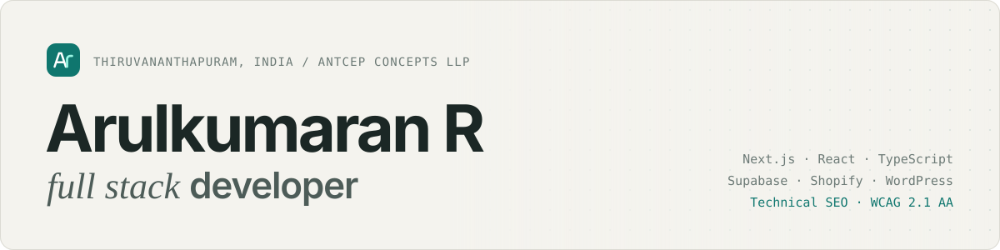

<a href="https://arulkumaran-portfolio-blush.vercel.app">
  <picture>
    <source media="(prefers-color-scheme: dark)" srcset="./assets/header-dark.svg">
    <source media="(prefers-color-scheme: light)" srcset="./assets/header-light.svg">
    
  </picture>
</a>

### Hi, I'm Arul.

I build web products end to end with **Next.js, TypeScript and Supabase**: internal platforms, online stores and company websites. I'm the developer who also cares how fast it loads, who can use it, and whether anyone can find it.

Right now I'm a full stack developer at **Antcep Concepts** in Thiruvananthapuram, where I own the internal HR and client platform, the company website and its CMS, Shopify work and client builds. Before that I spent three years at **Vinsinfo** in Chennai, going from associate developer to senior UI developer.

**[See my portfolio →](https://arulkumaran-portfolio-blush.vercel.app)**

 

### Selected work

Most of what I build is client or employer code, so it lives in private repositories. These write-ups cover the problem, what I did and how it turned out.

| Project | What it is | |
| :-- | :-- | :-- |
| **HR & Client Platform** | Internal Next.js + Supabase platform. 7 user roles, 9 modules, permissions enforced in the database with Row-Level Security. | [Case&nbsp;study](https://arulkumaran-portfolio-blush.vercel.app/projects/hr-hiring-client-management-platform) |
| **Company Website & CMS** | Next.js site with a custom admin CMS and a headless WordPress blog on ISR. Blog images cut from 1.6 MB to about 55 KB. | [Case&nbsp;study](https://arulkumaran-portfolio-blush.vercel.app/projects/nextjs-company-website-headless-cms) |
| **Website Audit SaaS** | My own product. 29-signal instant audit, plus a deep audit that renders sites at 11 widths and runs axe-core WCAG 2.1 AA scans. | [Case&nbsp;study](https://arulkumaran-portfolio-blush.vercel.app/projects/website-audit-saas) |
| **Shopify Theme Audit** | Line-by-line review of a 13,500-line Online Store 2.0 theme. 35 fixes, 0 Theme Check offences. | [Case&nbsp;study](https://arulkumaran-portfolio-blush.vercel.app/projects/shopify-theme-audit-optimisation) |
| **GSAP + WebGL Story Site** | Scroll-driven client site with a 240,000-particle WebGL scene, responsive from 360px to 1440px. | [Case&nbsp;study](https://arulkumaran-portfolio-blush.vercel.app/projects/gsap-webgl-scroll-storytelling-website) |
| **Lighthouse 47 → 98** | Performance and Core Web Vitals work on a client WordPress site. | [Case&nbsp;study](https://arulkumaran-portfolio-blush.vercel.app/projects/wordpress-core-web-vitals-lighthouse-47-to-98) |

 

### What I work with

**Frontend** · Next.js, React, TypeScript, Tailwind CSS, GSAP, WebGL 
**Backend** · Supabase, PostgreSQL, Row-Level Security, Node.js, PHP, REST APIs 
**CMS & e-commerce** · Shopify (Liquid, Online Store 2.0), WordPress (custom and headless), Elementor Pro, ACF Pro 
**Quality** · Technical SEO, Core Web Vitals, structured data, WCAG 2.1 AA, axe-core, NVDA 
**Delivery** · Git, GitHub Actions, Vercel, Cloudflare, GA4, Search Console

 

### How I work

- **Understand** the people and constraints first, and agree a short written plan.
- **Build** in small, reviewable pieces, with permissions in the database and checks on the risky paths.
- **Prove** it with numbers: Lighthouse, accessibility scans and Search Console.
- **Support** it after launch, fixing root causes rather than symptoms.

 

### On this profile

The public repositories here are smaller front-end builds and practice projects from earlier in my career: a responsive landing page, a CSS 3D slider, a custom select component and a few others. Each one has a README explaining what it is and what I'd improve today.

 

### Get in touch

Hiring, or have a project in mind? The fastest way is email.

[Portfolio](https://arulkumaran-portfolio-blush.vercel.app) · [LinkedIn](https://www.linkedin.com/in/arulkumaran-r) · [arulkumaranvp@gmail.com](mailto:arulkumaranvp@gmail.com)
